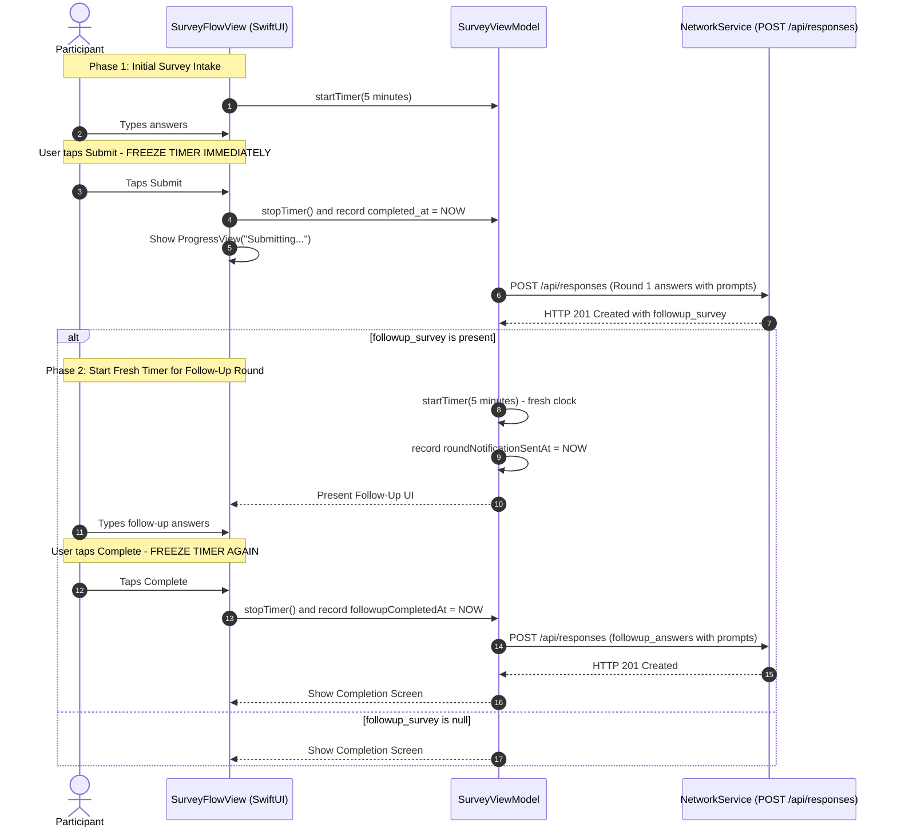

# iOS / Frontend Implementation Plan: Prompt Attribution, Independent Timers & OpenJev Inspection

## 1. Executive Summary & Core Objectives
This document establishes the frontend engineering specification for the **Simple Surveys iOS Application** (Xcode / Swift / SwiftUI) covering three core enhancements:

1. **Always-Attached Question Prompts**:
   - The iOS client will **always attach `question_prompt`** to every `AnswerItem` sent to `POST /api/responses`.
   - Applies uniformly to both initial survey questions and dynamic LLM follow-up questions, making responses self-describing while requiring zero backend lookup loops.
2. **Independent Timer Lifecycle (Submit Pause & Follow-Up Restart)**:
   - The countdown timer **pauses immediately** upon tapping "Submit", stamping `completed_at = Date()` so that network latency or LLM processing time never counts against the participant.
   - When a follow-up survey (`followup_survey`) is presented, a **brand new countdown timer begins** (resetting the full 5-minute window), setting `notification_sent_at` to the exact moment the follow-up round appeared on screen (`roundPresentedAt`). Note: No push notification is sent for follow-ups; the existing `notification_sent_at` field is reused as the presentation timestamp anchor.
3. **OpenJev Inconsistency Inspection & Mitigation via Inactivity Delay**:
   - Addresses mid-typing false positives caused by real-time immediate keystroke evaluation (e.g., typing *"I feel GREA"* triggering a 60% confidence score for feeling sad, but completing the sentence *"I am great"* dropping confidence back to 0%).
   - Enforces a mandatory **typing inactivity delay (500ms–750ms debounced pause)** so inference only runs once the participant has paused typing, paired with word boundary and minimum word count guards to eliminate question flickering.

---

## 2. Dynamic Question Prompt Attribution

### 2.1. Client-Side Mapping Rule
When constructing the `answers` array for `SurveyResponseCreate`, the client maps the question's prompt directly into the answer item:

```swift
// Uniform mapping across both regular surveys and follow-up rounds:
let answerItems = userAnswers.map { questionId, answerValue in
    let prompt = questions.first(where: { $0.questionId == questionId })?.prompt ?? ""
    return AnswerItem(
        questionId: questionId,
        questionPrompt: prompt,
        value: answerValue
    )
}
```

### 2.2. Advantages
- **Single Uniform Pipeline**: No `if isFollowup` branches in the iOS view model.
- **Zero Backend Work**: The backend simply persists the received array without executing prompt-enrichment loops.
- **Historical Portability**: Stored response records remain accurate even if researchers edit survey definitions later.

---

## 3. Independent Survey Timer Lifecycle



### 3.1. Timer Rules & Edge Case Handling
1. **Submit Button Freezes Time**:
   - The countdown timer is invalidated immediately on the main thread when "Submit" is pressed.
   - The user cannot suffer an expiration while waiting for a network response or server-side LLM synthesis.
2. **Fresh Countdown for Follow-Up**:
   - Upon receiving `followup_survey`, `startTimer(durationMinutes: 5)` resets the clock to 5:00.
   - `notification_sent_at` for the follow-up submission is stamped as the exact timestamp the follow-up round was displayed (`roundPresentedAt`), ensuring the backend audits Round 2 independently without needing a push notification event.

---

## 4. OpenJev Inconsistency Inspection & Mitigation Plan

### 4.1. The Root Cause: Immediate Keystroke Evaluation
The root cause of the inconsistency is that the iOS app currently evaluates OpenJev **immediately on every keystroke** with zero pause:
- When a user types `"I feel great"`, they briefly pass through `"I feel GREA"`.
- Because evaluation runs **immediately**, OpenJev evaluates the unfinished fragment `"I feel GREA"`.
- The sub-word tokenizer fragments `"GREA"` into rare out-of-distribution tokens, producing an anomalous 60% confidence score for feeling sad.
- When the user presses `'t'` to finish `"I feel great"`, the score immediately plunges to 0%.
- This causes the gated question to erratically flicker open and closed while the participant is actively typing.

---

### 4.2. The Solution: Typing Inactivity Delay (Debounced Pause)
The model must **never evaluate in real-time mid-keystroke**. Instead, the client must enforce a **typing inactivity delay (debounce)**:

```
User types "I" ──> User types " feel" ──> User types " GREA" ──> [Keystroke continues]
                                                                        │ (Evaluation CANCELLED)
                                                                        ▼
                                                         User finishes: "I feel great"
                                                                        │
                                                         User STOPS typing
                                                                        │
                                                         Wait for Inactivity Pause (500ms – 750ms)
                                                                        │
                                                         [Word Boundary + Min 3 Words Guard Pass]
                                                                        │
                                                                        ▼
                                                         Run OpenJev ONCE on complete thought!
                                                         Result: 0% (Clean, stable, zero flicker)
```

1. **Debounce Inactivity Window (500ms – 750ms)**:
   - When the user presses any key, any previously scheduled evaluation task is **immediately cancelled**.
   - A timer waits for **$500\text{ms} – 750\text{ms}$** of total typing silence.
   - If another key is pressed within that window, the timer cancels and resets.
   - Inference only runs once the user has paused or finished typing their clause.
2. **Immediate Evaluation on Field Blur (Keyboard Dismiss / Tap Outside)**:
   - If the user finishes typing and taps outside or dismisses the keyboard, the 500ms debounce timer is bypassed and evaluation runs once immediately on the final text.
3. **Word Boundary Guard**:
   - In addition to the pause, do not evaluate if the text ends in an incomplete word stem unless focus was lost.
4. **Minimum Word Count Threshold (Minimum 3 Words)**:
   - Meaningful sentiment cannot be inferred from 1–2 incomplete words (`"No"`, `"I"`, `"Yes"`). Enforce a minimum word count (at least 3 whitespace-separated tokens) before passing text to OpenJev:
     ```swift
     let wordCount = trimmed.split(whereSeparator: \.isWhitespace).count
     guard wordCount >= 3 else { return false }
     ```
5. **Hypothesis Phrasing & Threshold Calibration**:
   - Inspect the condition phrasing in the survey definition. Rather than ambiguous single-word hypotheses, use complete semantic predicates:
     - *Fragile*: `"sad"`
     - *Robust*: `"The participant expresses feeling unhappy, sad, or down"`
   - Calibrate the trigger threshold to **`0.60` – `0.65`** to prevent borderline activations.

---

## 5. Swift Data Models & ViewModel Implementation

### 5.1. Swift Models (`SurveyModels.swift`)

```swift
import Foundation

public struct AnswerItem: Codable, Sendable {
    public let questionId: String
    public let questionPrompt: String
    public let value: AnyCodable

    public init(questionId: String, questionPrompt: String, value: AnyCodable) {
        self.questionId = questionId
        self.questionPrompt = questionPrompt
        self.value = value
    }

    enum CodingKeys: String, CodingKey {
        case questionId = "question_id"
        case questionPrompt = "question_prompt"
        case value
    }
}

public struct SurveyResponseCreate: Codable, Sendable {
    public let surveyId: String
    public let notificationSentAt: String
    public let startedAt: String?
    public let completedAt: String?
    public let location: LocationCoordinates?
    public let answers: [AnswerItem]
    public let responseId: String?
    public let parentResponseId: String?
    public let researcherMessage: String?

    enum CodingKeys: String, CodingKey {
        case surveyId = "survey_id"
        case notificationSentAt = "notification_sent_at"
        case startedAt = "started_at"
        case completedAt = "completed_at"
        case location
        case answers
        case responseId = "response_id"
        case parentResponseId = "parent_response_id"
        case researcherMessage = "researcher_message"
    }
}
```

### 5.2. Input Guard Wrapper in `SurveyViewModel.swift`

```swift
@MainActor
public class SurveyViewModel: ObservableObject {
    @Published public var timeRemainingSeconds: Int = 300
    @Published public var isExpired: Bool = false
    @Published public var gatingVisibilityMap: [String: Bool] = [:]

    private var countdownTimer: Timer?
    private var gatingDebounceTask: Task<Void, Never>?
    private var initialNotificationSentAt: Date = Date()
    private var roundPresentedAt: Date = Date()
    private var initialCompletedAt: Date?
    private var roundCompletedAt: Date?

    // MARK: - Timer Control
    public func startTimer(durationMinutes: Int = 5) {
        stopTimer()
        self.timeRemainingSeconds = durationMinutes * 60
        self.isExpired = false
        self.roundPresentedAt = Date()

        self.countdownTimer = Timer.scheduledTimer(withTimeInterval: 1.0, repeats: true) { [weak self] _ in
            guard let self = self else { return }
            Task { @MainActor in
                if self.timeRemainingSeconds > 0 {
                    self.timeRemainingSeconds -= 1
                } else {
                    self.isExpired = true
                    self.stopTimer()
                }
            }
        }
    }

    public func stopTimer() {
        countdownTimer?.invalidate()
        countdownTimer = nil
    }

    // MARK: - Text Change Listener with Typing Inactivity Pause & OpenJev Guards
    public func handleTextChanged(questionId: String, newText: String) {
        // 1. Cancel previous pending task immediately on each new keystroke
        gatingDebounceTask?.cancel()

        gatingDebounceTask = Task {
            // 2. Wait for typing inactivity pause (600ms of typing silence)
            try? await Task.sleep(nanoseconds: 600_000_000)
            guard !Task.isCancelled else { return }

            // 3. OpenJev Guards: Check minimum word count (at least 3 words)
            let trimmed = newText.trimmingCharacters(in: .whitespacesAndNewlines)
            let wordCount = trimmed.split(whereSeparator: \.isWhitespace).count

            guard wordCount >= 3 else {
                await updateGatedQuestions(sourceQuestionId: questionId, isVisible: false)
                return
            }

            // 4. Run OpenJev once on the complete paused thought
            await evaluateGatesForQuestion(questionId: questionId, text: trimmed)
        }
    }

    // Call on field blur (keyboard dismiss / user taps outside) to bypass delay
    public func handleTextFieldBlur(questionId: String, currentText: String) {
        gatingDebounceTask?.cancel()
        let trimmed = currentText.trimmingCharacters(in: .whitespacesAndNewlines)
        let wordCount = trimmed.split(whereSeparator: \.isWhitespace).count
        guard wordCount >= 3 else {
            Task { await updateGatedQuestions(sourceQuestionId: questionId, isVisible: false) }
            return
        }
        Task { await evaluateGatesForQuestion(questionId: questionId, text: trimmed) }
    }

    // MARK: - Submit Initial Survey
    public func submitInitialSurvey() async {
        // FREEZE TIMER IMMEDIATELY
        stopTimer()
        self.initialCompletedAt = Date()

        // Build answers ALWAYS pairing question prompt
        let answerItems = currentAnswers.map { qId, val in
            let prompt = questions.first(where: { $0.questionId == qId })?.prompt ?? ""
            return AnswerItem(questionId: qId, questionPrompt: prompt, value: val)
        }

        let payload = SurveyResponseCreate(
            surveyId: survey.surveyId,
            notificationSentAt: ISO8601DateFormatter().string(from: initialNotificationSentAt),
            startedAt: ISO8601DateFormatter().string(from: initialNotificationSentAt),
            completedAt: ISO8601DateFormatter().string(from: initialCompletedAt!),
            location: currentLocation,
            answers: answerItems,
            responseId: nil,
            parentResponseId: nil,
            researcherMessage: nil
        )

        let result = await networkService.submitResponse(payload, image: capturedImage)

        if let followup = result?.followupSurvey {
            transitionToFollowUpRound(followup)
        } else {
            transitionToCompleted()
        }
    }

    // MARK: - Transition to Follow-Up Round
    private func transitionToFollowUpRound(_ followup: FollowUpSurveyPayload) {
        self.currentFollowup = followup
        self.currentAnswers.removeAll()

        // START FRESH TIMER FOR FOLLOW-UP ROUND
        startTimer(durationMinutes: 5)
    }

    // MARK: - Submit Follow-Up Survey
    public func submitFollowUpSurvey() async {
        // FREEZE TIMER IMMEDIATELY
        stopTimer()
        self.roundCompletedAt = Date()

        guard let followup = currentFollowup else { return }

        let answerItems = currentAnswers.map { qId, val in
            let prompt = followup.questions.first(where: { $0.questionId == qId })?.prompt ?? ""
            return AnswerItem(questionId: qId, questionPrompt: prompt, value: val)
        }

        let payload = SurveyResponseCreate(
            surveyId: followup.surveyId,
            notificationSentAt: ISO8601DateFormatter().string(from: roundPresentedAt),
            startedAt: ISO8601DateFormatter().string(from: roundPresentedAt),
            completedAt: ISO8601DateFormatter().string(from: roundCompletedAt!),
            location: currentLocation,
            answers: answerItems,
            responseId: nil,
            parentResponseId: followup.parentResponseId,
            researcherMessage: followup.researcherMessage
        )

        let _ = await networkService.submitResponse(payload, image: nil)
        transitionToCompleted()
    }
}
```

---

## 6. Frontend Implementation Checklist

- [ ] **Prompt Attribution**:
  - [ ] Update `AnswerItem` in `SurveyModels.swift` with non-optional `questionPrompt: String`.
  - [ ] Ensure `submitInitialSurvey` and `submitFollowUpSurvey` map `question.prompt` into `questionPrompt` for all answers.
- [ ] **Independent Timer Control**:
  - [ ] Call `stopTimer()` immediately at the beginning of `submitInitialSurvey()`.
  - [ ] Call `startTimer(durationMinutes: 5)` when `followup_survey` is presented.
  - [ ] Record `roundPresentedAt = Date()` and send it as `notification_sent_at` on follow-up submission.
- [ ] **OpenJev Inactivity Delay & Inconsistency Guards**:
  - [ ] Implement typing inactivity delay timer (500ms–750ms debounce) that cancels previous evaluations on every keystroke.
  - [ ] Implement immediate evaluation on text field blur / focus lost.
  - [ ] Implement minimum 3-word count check before triggering ONNX evaluation.
  - [ ] Profile mid-typing strings (e.g. `"I feel GREA"` vs `"I am great"`) to verify zero question flickering.
  - [ ] Confirm fail-closed behavior defaults to `false` without crashing if evaluation errors occur.
