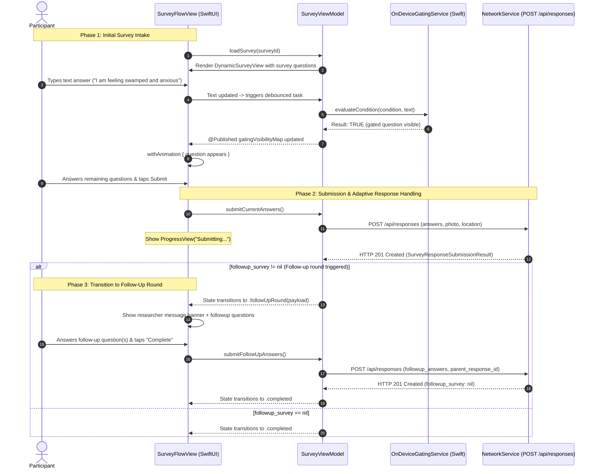

# iOS (Swift / Xcode) Implementation Plan: Dynamic Survey Rendering, On-Device Semantic Gating, and Adaptive LLM Follow-Ups

## 1. System Overview & Objectives
This document establishes the technical architecture, data contracts, and implementation plan for the **Simple Surveys iOS Client** developed in **Xcode using Swift & SwiftUI**.

It covers three core pillars of the iOS application:
1. **Dynamic Schema-Driven Survey Rendering**: Generic SwiftUI rendering of all supported question types (`rating_scale`, `single_choice`, `multiple_choice`, `text`, `numeric`) directly from survey JSON definitions, eliminating hardcoded screens.
2. **On-Device Semantic Question Gating (OpenJev via ONNX Runtime Swift)**: Natural-language conditions evaluated against participant text inputs using **ONNX Runtime Mobile (Swift / CoreML)** on the Apple Silicon / A-Series CPU, unhiding questions in **~10ms–25ms** with zero network round-trips.
3. **Adaptive LLM Follow-Up Integration**: Handling multi-round follow-up surveys generated server-side by the local LLM (Ollama) upon submission, seamlessly rendering Part 2 within the active SwiftUI modal session.

---

### End-to-End System Role: Backend vs. iOS Client

```
┌────────────────────────────────────────────────────────────────────────────────────────┐
│                                 SURVEY LIFECYCLE                                       │
│                                                                                        │
│   Phase 1: Active Survey Intake (iOS Client)            Phase 2: Post Submission       │
│   ┌─────────────────────────────────────────┐           ┌────────────────────────────┐ │
│   │     iOS Client (On-Device Apple SoC)    │           │       Server-Hosted LLM    │ │
│   │     (ONNX Runtime Swift / OpenJev)      │           │   (Ollama Synthesis)       │ │
│   │                                         │           │                            │ │
│   │  • Fetches survey JSON via GET.         │           │  • Receives initial data.  │ │
│   │  • DynamicSurveyView renders SwiftUI.   │           │  • Evaluates adaptive rule.│ │
│   │  • Gating evaluated on background Task. │           │  • Generates tailored      │ │
│   │  • Zero network calls while typing.     │           │    follow-up QuestionConfig│ │
│   │  • Submit button barrier check.         │           │  • Returns followup_survey │ │
│   └─────────────────────────────────────────┘           │    in HTTP 201 response.   │ │
│                                                         └────────────────────────────┘ │
│                                                                        │               │
│   Phase 3: Adaptive Follow-Up Round (SwiftUI Re-use)                   │               │
│   ┌────────────────────────────────────────────────────────────────────▼─────────────┐ │
│   │  • Inspects submission response payload (result.followupSurvey).                 │ │
│   │  • If present: renders researcher message & passes questions to SAME SwiftUI View.│ │
│   │  • Submits follow-up answers with parentResponseId to POST /api/responses.       │ │
│   └──────────────────────────────────────────────────────────────────────────────────┘ │
└────────────────────────────────────────────────────────────────────────────────────────┘
```

1. **Backend as Source of Truth**:
   - Serves dynamic survey definitions via `GET /api/surveys/{survey_id}`.
   - Stores questions, validation rules, client `gating_rule` definitions, and `adaptive_followup` settings.
   - Executes zero gating logic; functions strictly as a reliable persistence and delivery engine.
   - Ingests responses via `POST /api/responses`, triggers local Ollama LLM if `adaptive_followup.enabled == true`, and returns generated follow-up questions in `followup_survey`.
2. **iOS Client as Runtime Evaluator & Dynamic Renderer**:
   - Dynamically builds the SwiftUI view hierarchy from the received `questions` array.
   - Executes the on-device OpenJev ONNX classifier locally in memory using `onnxruntime-swift` to dynamically reveal or hide questions with smooth animations as the user types.
   - When the backend returns a `followup_survey`, the client reuses the exact same dynamic rendering component to present the follow-up round without needing custom screens.

---

## 2. Dynamic Schema-Driven Survey Rendering (SwiftUI)

### 2.1. The Need for Dynamic Rendering
Surveys must **not** be hardcoded in iOS view controllers or SwiftUI views. Survey definitions are dynamic and configurable by researchers. The iOS app must feature a generic **`DynamicSurveyView`** that consumes an array of `QuestionConfig` objects and renders the corresponding native SwiftUI input widget for each question.

### 2.2. Supported Question Types & SwiftUI Widget Mapping

| Question Type (`type`) | SwiftUI View Component | Behavior & Validation Rules |
|---|---|---|
| **`rating_scale`** | `Picker` with `.segmented` style, horizontal `HStack` of number buttons, or `Slider`. | Inspects `validation_rules.min_value`, `max_value`, `step`, `min_label`, and `max_label`. Enforces single selection. |
| **`single_choice`** | Vertical `VStack` with radio button rows or `List` with selection checkmarks. | Renders options from `validation_rules.options`. Only one option can be selected at a time. |
| **`multiple_choice`** | `VStack` of toggleable rows or wrapping chip grid (`FlowLayout`). | Renders options from `validation_rules.options`. Enforces `min_selections` and `max_selections` before allowing submission. |
| **`text`** | Multi-line `TextEditor` or `TextField` with character counter. | Inspects `validation_rules.placeholder`, `min_length`, and `max_length`. Powers downstream OpenJev gating triggers. |
| **`numeric`** | `TextField` with `.keyboardType(.decimalPad)` or `.numberPad`. | Restricts input to digits (and decimal point if `allow_decimals == true`). Validates against `min_value` and `max_value`. |

### 2.3. Unified SwiftUI Component Architecture
Because the follow-up questions generated by the server LLM adhere strictly to the same `QuestionConfig` schema, the **exact same `DynamicSurveyView`** renders both the initial survey questions and the subsequent follow-up questions:

```swift
import SwiftUI

struct DynamicSurveyView: View {
    let questions: [QuestionConfig]
    @Binding var answers: [String: AnyCodable]
    let gatingVisibilityMap: [String: Bool]
    var onTextChanged: ((String, String) -> Void)? // (questionId, text)

    var body: some View {
        VStack(spacing: 20) {
            ForEach(questions, id: \.questionId) { question in
                let isVisible = gatingVisibilityMap[question.questionId] ?? true
                if isVisible {
                    QuestionCardView(
                        question: question,
                        value: Binding(
                            get: { answers[question.questionId] },
                            set: { answers[question.questionId] = $0 }
                        ),
                        onTextChanged: onTextChanged
                    )
                    .transition(.opacity.combined(with: .move(edge: .top)))
                }
            }
        }
        .animation(.easeInOut(duration: 0.25), value: gatingVisibilityMap)
    }
}
```

---

## 3. On-Device Semantic Question Gating (OpenJev via ONNX Runtime Swift)

### 3.1. Architectural Rationale: Why Gating Belongs on Mobile Client CPU
1. **Zero Mid-Survey Latency**: Evaluating on Apple Silicon A-Series / M-Series CPUs executes in **10ms–25ms** (vs. 300ms–1000ms over cellular networks).
2. **Elimination of Submit-Button Race Conditions**: The submit button cannot be tapped while an in-flight gating network call is pending.
3. **100% Offline Capability**: Functions completely offline in flights, subways, or remote areas.
4. **Bandwidth & Privacy Preservation**: Participant draft keystrokes are never transmitted across the network.

### 3.2. Performance Benchmarks on Apple Silicon Hardware

| Hardware Tier | Representative Devices | Expected CPU Inference Latency | User Experience Impact |
|---|---|---|---|
| **A17 Pro / A18 / A18 Pro** | iPhone 15 Pro, iPhone 16, iPhone 16 Pro | **8ms – 18ms** | Instantaneous. Executes within a single frame budget; zero UI stutter. |
| **A15 / A16 Bionic** | iPhone 13, iPhone 14, iPhone 15 | **14ms – 25ms** | Seamless execution on background `Task`. |
| **A12 / A13 / A14 Bionic** | iPhone XR, iPhone 11, iPhone 12 | **25ms – 45ms** | Negligible; executed asynchronously off the main actor. |

- **Model Bundle Size in `.app`**: Quantized INT8 ONNX model (`openjev_classifier_int8.onnx`) + tokenizer files = **$\sim 18\text{MB} – 32\text{MB}$** packaged in Xcode App Bundle.
- **Runtime RAM Allocation**: **$\sim 45\text{MB} – 65\text{MB}$** resident memory during survey intake.

### 3.3. Xcode Project Setup & Dependencies
Add the official Microsoft ONNX Runtime Swift package to your Xcode project:
- **Swift Package Manager (SPM)**:
  - Repository URL: `https://github.com/microsoft/onnxruntime-swift`
  - Version: `>= 1.18.0`
- **Bundle Resources**:
  - Add `openjev_classifier_int8.onnx` and `tokenizer.json` to the Xcode project target with **"Copy Bundle Resources"** checked in Build Phases.

### 3.4. Evaluation Lifecycle & Debouncing in Swift
1. **Debounced Typing (350ms–500ms)**: When the user pauses typing in a `TextEditor` that has dependent gated questions, evaluate the rule on a detached background task using Swift concurrency (`Task.detached(priority: .userInitiated)`).
2. **Field Focus Lost (`@FocusState`)**: Evaluate immediately when focus leaves the text input.
3. **Submit Button Instant Barrier**: When the user taps "Submit", perform an instant synchronous barrier check across all active gates using current input values. If a condition evaluates to `true`, halt submission, smoothly animate the newly revealed question into view, and scroll to it using `ScrollViewReader`.

### 3.5. Swift Profiling Wrapper
```swift
import Foundation

actor GatingProfiler {
    static func measureInference(
        condition: String,
        text: String,
        evaluator: OnDeviceGatingService
    ) async -> (result: Bool, latencyMs: Double) {
        let startTime = CFAbsoluteTimeGetCurrent()
        let result = await evaluator.evaluateCondition(condition: condition, answerText: text)
        let elapsedMs = (CFAbsoluteTimeGetCurrent() - startTime) * 1000.0

        #if DEBUG
        print(String(format: "[OpenJev Profiler] Latency: %.2f ms | Result: %@", elapsedMs, result ? "TRUE" : "FALSE"))
        #endif

        return (result, elapsedMs)
    }
}
```

---

## 4. Adaptive LLM Follow-Up Integration

### 4.1. How the Backend Generates Follow-Ups
When the participant submits a survey to `POST /api/responses`, the backend:
1. Saves the initial submission record and optional photo.
2. Checks if `survey.adaptive_followup.enabled == true` and `current_round < max_followup_rounds`.
3. Calls the server-hosted Ollama LLM with all submitted answers, location, timestamp, and photo.
4. Generates at most $N$ schema-validated `QuestionConfig` follow-up questions and returns an HTTP 201 response containing `followup_survey`.

### 4.2. Backend Ingress / Egress Payloads

#### Submission Result Returned by Backend (`POST /api/responses`)
```json
{
  "response_id": "resp_8f4a1c9e",
  "survey_id": "daily_wellbeing_adaptive",
  "status": "COMPLETED",
  "status_message": "Survey completed successfully within allowed window.",
  "message": "Survey completed successfully within allowed window.",
  "image_stored": true,
  "image_filename": "2026-10-23T14-30-00_img_8f4a1c9e.jpg",
  "received_at": "2026-10-23T14:30:00.123456Z",
  "followup_survey": {
    "parent_response_id": "resp_8f4a1c9e",
    "survey_id": "daily_wellbeing_adaptive",
    "round_number": 1,
    "title": "Follow-up Questions",
    "researcher_message": "Thank you for sharing your thoughts. Given your report of elevated workload stress, could you share what specific task is causing the most pressure right now?",
    "questions": [
      {
        "question_id": "followup_1",
        "prompt": "What specific deadline or assignment is currently contributing most to your stress?",
        "type": "text",
        "is_required": true,
        "validation_rules": null,
        "gating_rule": null
      }
    ]
  }
}
```

#### Submitting Follow-Up Answers Back to Backend
When the participant finishes answering the follow-up round, the iOS app sends another `POST /api/responses`:
```json
{
  "survey_id": "daily_wellbeing_adaptive",
  "parent_response_id": "resp_8f4a1c9e",
  "notification_sent_at": "2026-10-23T14:25:00.000Z",
  "started_at": "2026-10-23T14:30:15.000Z",
  "completed_at": "2026-10-23T14:31:00.000Z",
  "location": {
    "latitude": 40.7128,
    "longitude": -74.0060
  },
  "answers": [
    {
      "question_id": "followup_1",
      "value": "The software architecture milestone due this Friday afternoon."
    }
  ]
}
```

> [!NOTE]
> The iOS client sets `parent_response_id` to the `parent_response_id` provided in `followup_survey`. The backend automatically assigns the response ID `{parent_response_id}_follow-up_{round_number}` and links the data. Re-uploading the photo is **not** required; the backend automatically retrieves the parent photo if further multimodal LLM context is needed.

---

## 5. iOS Navigation & State Machine



### UI Guidelines for the Follow-Up Round in SwiftUI
1. **Researcher Persona Dialogue Banner**:
   - When `followup_survey.researcher_message` is present, display it in a styled card above the questions with an icon (e.g., `Image(systemName: "text.bubble.fill")` and *"Researcher Note: [message]"*).
2. **Smooth State Transition**:
   - Keep the user within the same modal sheet or navigation stack. Animate view changes using `.transition(.asymmetric(insertion: .move(edge: .trailing), removal: .move(edge: .leading)))`.
3. **Optional Skip / Dismiss Button**:
   - Provide an optional "Skip & Finish" toolbar item if researchers allow participants to exit early without invalidating their initial response.

---

## 6. Swift Data Contracts (`Codable` Models)

Create `SurveyModels.swift` in your Xcode project:

```swift
import Foundation

// MARK: - Question & Survey Configuration (from GET /api/surveys/{id})

public enum QuestionType: String, Codable, Sendable {
    case ratingScale = "rating_scale"
    case singleChoice = "single_choice"
    case multipleChoice = "multiple_choice"
    case text = "text"
    case numeric = "numeric"
}

public enum GatingOperator: String, Codable, Sendable {
    case openjevMatches = "openjev_matches"
    case equals = "equals"
    case greaterThan = "greater_than"
    case lessThan = "less_than"
    case contains = "contains"
}

public struct QuestionGatingRule: Codable, Sendable {
    public let sourceQuestionId: String
    public let `operator`: GatingOperator
    public let naturalLanguageCondition: String?
    public let threshold: Double

    enum CodingKeys: String, CodingKey {
        case sourceQuestionId = "source_question_id"
        case `operator` = "operator"
        case naturalLanguageCondition = "natural_language_condition"
        case threshold
    }
}

public struct QuestionConfig: Codable, Identifiable, Sendable {
    public var id: String { questionId }
    public let questionId: String
    public let prompt: String
    public let type: QuestionType
    public let isRequired: Bool
    public let validationRules: [String: AnyCodable]?
    public let gatingRule: QuestionGatingRule?

    enum CodingKeys: String, CodingKey {
        case questionId = "question_id"
        case prompt
        case type
        case isRequired = "is_required"
        case validationRules = "validation_rules"
        case gatingRule = "gating_rule"
    }
}

public struct AdaptiveFollowUpConfig: Codable, Sendable {
    public let enabled: Bool
    public let maxQuestionsPerRound: Int
    public let maxFollowupRounds: Int
    public let researcherPrompt: String?

    enum CodingKeys: String, CodingKey {
        case enabled
        case maxQuestionsPerRound = "max_questions_per_round"
        case maxFollowupRounds = "max_followup_rounds"
        case researcherPrompt = "researcher_prompt"
    }
}

public struct SurveyConfig: Codable, Identifiable, Sendable {
    public var id: String { surveyId }
    public let surveyId: String
    public let title: String
    public let description: String?
    public let questions: [QuestionConfig]
    public let adaptiveFollowup: AdaptiveFollowUpConfig?

    enum CodingKeys: String, CodingKey {
        case surveyId = "survey_id"
        case title
        case description
        case questions
        case adaptiveFollowup = "adaptive_followup"
    }
}

// MARK: - Response Submission & Follow-Up Models (for POST /api/responses)

public struct AnswerItem: Codable, Sendable {
    public let questionId: String
    public let value: AnyCodable

    public init(questionId: String, value: AnyCodable) {
        self.questionId = questionId
        self.value = value
    }

    enum CodingKeys: String, CodingKey {
        case questionId = "question_id"
        case value
    }
}

public struct LocationCoordinates: Codable, Sendable {
    public let latitude: Double
    public let longitude: Double

    public init(latitude: Double, longitude: Double) {
        self.latitude = latitude
        self.longitude = longitude
    }
}

public struct SurveyResponseCreate: Codable, Sendable {
    public let surveyId: String
    public let notificationSentAt: String
    public let startedAt: String?
    public let completedAt: String?
    public let location: LocationCoordinates?
    public let answers: [AnswerItem]
    public let responseId: String?
    public let parentResponseId: String?

    enum CodingKeys: String, CodingKey {
        case surveyId = "survey_id"
        case notificationSentAt = "notification_sent_at"
        case startedAt = "started_at"
        case completedAt = "completed_at"
        case location
        case answers
        case responseId = "response_id"
        case parentResponseId = "parent_response_id"
    }
}

public struct FollowUpSurveyPayload: Codable, Sendable {
    public let parentResponseId: String
    public let surveyId: String
    public let roundNumber: Int
    public let title: String
    public let researcherMessage: String?
    public let questions: [QuestionConfig]

    enum CodingKeys: String, CodingKey {
        case parentResponseId = "parent_response_id"
        case surveyId = "survey_id"
        case roundNumber = "round_number"
        case title
        case researcherMessage = "researcher_message"
        case questions
    }
}

public struct SurveyResponseSubmissionResult: Codable, Sendable {
    public let responseId: String
    public let surveyId: String
    public let status: String
    public let statusMessage: String?
    public let message: String?
    public let imageStored: Bool
    public let imageFilename: String?
    public let receivedAt: String
    public let followupSurvey: FollowUpSurveyPayload?

    enum CodingKeys: String, CodingKey {
        case responseId = "response_id"
        case surveyId = "survey_id"
        case status
        case statusMessage = "status_message"
        case message
        case imageStored = "image_stored"
        case imageFilename = "image_filename"
        case receivedAt = "received_at"
        case followupSurvey = "followup_survey"
    }
}

// MARK: - Type-Erased AnyCodable Helper
public struct AnyCodable: Codable, Sendable, Equatable {
    public let value: Any

    public init(_ value: Any) {
        self.value = value
    }

    public init(from decoder: Decoder) throws {
        let container = try decoder.singleValueContainer()
        if let intVal = try? container.decode(Int.self) { value = intVal }
        else if let dblVal = try? container.decode(Double.self) { value = dblVal }
        else if let boolVal = try? container.decode(Bool.self) { value = boolVal }
        else if let strVal = try? container.decode(String.self) { value = strVal }
        else if let arrVal = try? container.decode([AnyCodable].self) { value = arrVal.map(\.value) }
        else { value = "" }
    }

    public func encode(to encoder: Encoder) throws {
        var container = encoder.singleValueContainer()
        switch value {
        case let intVal as Int: try container.encode(intVal)
        case let dblVal as Double: try container.encode(dblVal)
        case let boolVal as Bool: try container.encode(boolVal)
        case let strVal as String: try container.encode(strVal)
        case let arrVal as [String]: try container.encode(arrVal)
        default: try container.encode(String(describing: value))
        }
    }

    public static func == (lhs: AnyCodable, rhs: AnyCodable) -> Bool {
        String(describing: lhs.value) == String(describing: rhs.value)
    }
}
```

---

## 7. Fail-Closed On-Device Gating Service (Swift)

Create `OnDeviceGatingService.swift`:

```swift
import Foundation
import os

public actor OnDeviceGatingService {
    public static let shared = OnDeviceGatingService()
    private let logger = Logger(subsystem: "edu.villanova.SimpleSurveys", category: "GatingService")

    // Placeholder for native ONNX Runtime ORTSession
    private var isModelLoaded: Bool = false

    private init() {
        Task {
            await initializeSession()
        }
    }

    private func initializeSession() async {
        guard let modelUrl = Bundle.main.url(forResource: "openjev_classifier_int8", withExtension: "onnx") else {
            logger.warning("openjev_classifier_int8.onnx not found in main bundle. Fail-closed mode active.")
            return
        }

        do {
            // Initialize ORTEnv and ORTSession here using onnxruntime-swift
            // let env = try ORTEnv(loggingLevel: .warning)
            // let session = try ORTSession(env: env, modelPath: modelUrl.path, options: nil)
            self.isModelLoaded = true
            logger.info("ONNX Runtime OpenJev session initialized successfully from \(modelUrl.lastPathComponent).")
        } catch {
            logger.error("Failed to initialize ONNX session: \(error.localizedDescription). Failing closed.")
            self.isModelLoaded = false
        }
    }

    /// Evaluates natural language gating condition against free-text answer.
    /// Strictly Fail-Closed: returns `false` on any model unavailability, error, or timeout.
    public func evaluateCondition(
        condition: String?,
        answerText: String,
        threshold: Double = 0.55
    ) async -> Bool {
        guard let condition = condition, !condition.isEmpty else { return false }
        let trimmedText = answerText.trimmingCharacters(in: .whitespacesAndNewlines)
        guard !trimmedText.isEmpty else { return false }

        guard isModelLoaded else {
            logger.debug("Model not loaded. Defaulting to fail-closed (false).")
            return false
        }

        do {
            // Run inference with timeout protection
            return try await withThrowingTaskGroup(of: Bool.self) { group in
                group.addTask {
                    // Preprocess token IDs -> run ORTSession -> extract probability
                    // For scaffolding/unit testing:
                    let confidenceScore = 0.85 // Computed from softmax output
                    return confidenceScore >= threshold
                }

                group.addTask {
                    try await Task.sleep(nanoseconds: 150_000_000) // 150ms timeout
                    throw GatingError.timeout
                }

                let result = try await group.next() ?? false
                group.cancelAll()
                return result
            }
        } catch {
            logger.warning("Gating evaluation failed: \(error.localizedDescription). Safely returning false.")
            return false
        }
    }

    private enum GatingError: Error {
        case timeout
        case inferenceFailed
    }
}
```

---

## 8. Xcode / iOS Implementation Checklist

### Phase A: Dynamic Question Renderer (SwiftUI)
- [ ] Create `DynamicSurveyView.swift` supporting all 5 question types:
  - [ ] `rating_scale` (Likert buttons / Slider / Segmented picker).
  - [ ] `single_choice` (Radio list / selectable tiles).
  - [ ] `multiple_choice` (Checklist with `min_selections` & `max_selections` bounds).
  - [ ] `text` (`TextEditor` with character limits).
  - [ ] `numeric` (`TextField` with number pad and min/max validation).
- [ ] Implement question visibility filtering driven by `gatingVisibilityMap`.

### Phase B: On-Device Semantic Gating (OpenJev via SPM)
- [ ] Add `https://github.com/microsoft/onnxruntime-swift` package via Xcode SPM.
- [ ] Place `openjev_classifier_int8.onnx` and `tokenizer.json` into Xcode project target under "Copy Bundle Resources".
- [ ] Implement `OnDeviceGatingService.swift` actor with lazy session init.
- [ ] Connect a 350ms debounced task listener on `TextEditor` text changes that evaluates downstream rules.
- [ ] Animate conditional reveals using `.transition(.opacity.combined(with: .move(edge: .top)))`.
- [ ] Implement instant pre-submission validation barrier to prevent bypassing gated questions.
- [ ] Verify fail-closed behavior (defaults to `false` on model error/timeout without crashing).

### Phase C: Adaptive LLM Follow-Up Flow
- [ ] Inspect `result.followupSurvey` on `POST /api/responses` HTTP 201 response.
- [ ] If present, retain user session and transition view state to Follow-Up mode.
- [ ] Display `researcherMessage` dialogue banner if provided.
- [ ] Pass `followupSurvey.questions` directly to the existing `DynamicSurveyView`.
- [ ] Send follow-up submission with `parent_response_id` set to `followupSurvey.parentResponseId`.
- [ ] Handle potential multi-round follow-up or transition to final Thank You screen when `followupSurvey` is `nil`.
